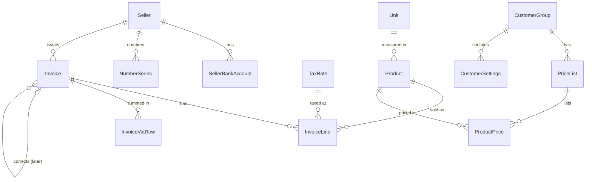

# ERD: Invoicing

- **Module:** `invoicing`, tenant-scoped (every table has a `tenantId`)
- **PRD:** [Invoicing](../prd/invoicing.md). Requirement ids (N2, I3 and so on) refer to it.
- **Status:** Draft
- **Date:** 2026-11-24

## 1. Diagram

The customer and the seller's company are **not** tables here: they are ids of Parties companies, held without a foreign key (ADR 0009, rule 1), and every use goes through the Parties lookup. Currencies are ISO codes in text columns. `Invoice` and its parts are the only tables other modules ever learn about, through the Contracts.

## 2. Conventions of every table

| Column | Type | Meaning |
|---|---|---|
| `id` | uuid | Primary key, time-ordered (version 7) |
| `tenantId` | uuid | The tenant; part of every unique index and of every foreign key between tables of this module (the key `(tenantId, id)` exists on every table, as in the Parties ERD) |
| `createdAt`, `updatedAt` | timestamp (UTC) | Maintained by the platform |
| `version` | text | Concurrency token (X1) on every table users change |
| `legacyId` | text(100), null | Identifier in the old system, prefixed with the system (G1). Unique per tenant where not null. Internal |

**Money and numbers.** Amounts are `numeric(14,2)` (the currency's decimals are 2 for every currency the module accepts in v1; a currency with other decimals is refused until a column per currency is justified), quantities `numeric(14,4)`, rates in percent `numeric(5,2)`, the conversion rate `numeric(18,6)`. Currencies are `char(3)` ISO 4217 in upper case. Dates are `date`. Text comparison keys are computed by the application.

## 3. Tables

### Seller

| Column | Type | Null | Notes |
|---|---|---|---|
| `companyId` | uuid | no | The Parties company. No foreign key. Unique per tenant |
| `defaultCurrency`, `accountingCurrency` | char(3) | no | |
| `defaultPaymentTermDays` | int | no | 0 or more |
| `defaultPrintLanguage` | text(10) | yes | |
| `status` | text | no | `active` or `deactivated` |

### SellerBankAccount

`sellerId` (foreign key), `name` (text 100), `iban` (text 34, null), `swift` (text 11, null), `accountNumber` (text 50, null), `isDefault` (boolean), `defaultMarker` (boolean, null: true for the default, null otherwise). At least one of `iban` and `accountNumber` is not null. Unique `(tenantId, sellerId, defaultMarker)`: at most one default account per seller. PostgreSQL treats nulls in a unique index as different, and the SQL Server provider of EF Core makes a unique index over a nullable column a filtered one (`WHERE defaultMarker IS NOT NULL`) by convention, so any number of non-default accounts is allowed on both (the same device as the primary address of the Parties ERD; the contract tests prove it).

### NumberSeries

| Column | Type | Null | Notes |
|---|---|---|---|
| `sellerId` | uuid | no | Foreign key |
| `documentType` | text | no | `invoice` (v1) |
| `format` | text(100) | no | Must contain `{counter:N}`; may contain `{yyyy}` |
| `firstCounter` | bigint | no | At least 1 |
| `status` | text | no | `active` or `retired` |
| `activeMarker` | boolean | yes | `true` while active, null once retired: unique `(tenantId, sellerId, documentType, activeMarker)` gives one active series per seller and type (N1) and any number of retired ones (nulls are distinct on PostgreSQL; the SQL Server provider makes the index a filtered one over the non-null marker) |

The counters are kept by the platform's sequence service: a row per key that the service updates inside the transaction of the save (not a database sequence object, so a rollback gives the number back). The key is `invoicing.invoice:<sellerId>:<seriesId>:<year>` (the year `0000` when the format has no `{yyyy}`); the series id is in it, so a series that replaces another with the same format starts its own counter and never meets the retired one's numbers. The row is created when first needed, idempotently. The table holds the rule; the sequence holds the counter. Legacy numbers (N4) are not in the sequence: the migration starts the new series above the highest of them.

### TaxRate

`name` (text 100), `ratePercent` (numeric 5,2, 0 to 100), `validFrom`, `validTo` (date, null), `isStandard` (boolean), `status`. Check: `validTo` is null or not before `validFrom`. Unique `(tenantId, name)`.

### Unit, Product, CustomerGroup

`Unit`: `name` (text 100), `status`. `Product`: `name` (text 255), `sku` (text 100, null, unique per tenant where not null), `unitId` (foreign key), `status`. `CustomerGroup`: `name` (text 255), `status`. Unique `(tenantId, name)` on `Unit` and `CustomerGroup`.

### CustomerSettings

`customerCompanyId` (uuid, the Parties company, no foreign key; unique per tenant), `customerGroupId` (foreign key, null), `invoicingEmail` (text 320, null).

### PriceList and ProductPrice

`PriceList`: `name` (text 255), `customerGroupId` (foreign key), `validFrom`, `validTo` (date, null), `status`. Check: `validTo` is null or not before `validFrom`.
`ProductPrice`: `priceListId`, `productId` (foreign keys), `currency` (char 3, null: any currency), `unitPrice` (numeric 14,2, not negative). Unique `(tenantId, priceListId, productId, currency)` over the three columns, with a null currency counted as one more value, so there is one price per product, list and currency: the application writes the any-currency price with `currencyKey` = `*` (a text column, `*` for any, else the code) and the unique index is on `currencyKey`, which is the same on both databases.

### Invoice

| Column | Type | Null | Notes |
|---|---|---|---|
| `documentType` | text | no | `invoice` (v1); `creditNote` later |
| `correctsInvoiceId` | uuid | yes | The invoice a credit note corrects; always null in v1 |
| `sellerId` | uuid | no | Foreign key |
| `customerCompanyId` | uuid | no | Parties company, no foreign key |
| `currency` | char(3) | no | |
| `issueDate`, `taxPointDate`, `dueDate` | date | no | |
| `paymentTermDays` | int | no | 0 or more |
| `printLanguage` | text(10) | yes | |
| `isReverseCharge` | boolean | no | |
| `bankAccountId` | uuid | yes | Foreign key; must belong to the same seller (composite foreign key with `sellerId`) |
| `note` | text(2000) | yes | |
| `conversionRate` | numeric(18,6) | no | To the seller's accounting currency; 1 when the currency is the accounting currency; greater than 0 |
| `status` | text | no | `draft` or `confirmed` |
| `documentNumber` | text(255) | yes | Null for a draft. Unique `(tenantId, sellerId, documentNumber)` where not null (N3) |
| `confirmedAt` | timestamp | yes | Not null exactly when `status` is `confirmed` |
| `totalLines`, `grandTotal` | numeric(14,2) | yes | Null for a draft; in the invoice currency |
| `totalLinesAccounting`, `grandTotalAccounting` | numeric(14,2) | yes | In the accounting currency |
| `snapshot` | jsonb / nvarchar(max) | yes | The seller and the customer as they were at confirmation (I4): name, registration and tax numbers, address, e-mail, the bank account |
| `snapshotSource` | text | yes | `confirmation` or `migration` (G4) |
| `legacyNumber` | boolean | no | True for an invoice loaded with its old number (N4): the number came from outside the series |

Checks: `status` in `draft`, `confirmed`; a confirmed invoice has `documentNumber`, `confirmedAt`, all four totals and a snapshot; a draft has none of them. There is no check between the three dates: a due date before the issue date is the user's business. Indexes: `(tenantId, sellerId, issueDate)`, `(tenantId, customerCompanyId)`, `(tenantId, taxPointDate)` where confirmed (tax reads), `(tenantId, documentNumber)`, unique `(tenantId, legacyId)` where not null.

### InvoiceLine

`invoiceId` (foreign key), `position` (int, unique per invoice), `productId` (foreign key, null), `narration` (text 1000), `quantity` (numeric 14,4), `unitPrice` (numeric 14,2, null when the total was typed), `taxRateId` (foreign key), `taxRatePercent` (numeric 5,2: the rate at the time, copied), `lineTotal` (numeric 14,2). A line belongs to a draft until the invoice is confirmed; the application refuses changes afterwards (I5), and a trigger-free check is not possible on both databases, so the contract test proves it.

### InvoiceVatRow

`invoiceId` (foreign key), `ratePercent` (numeric 5,2), `base`, `vat`, `total` (numeric 14,2) and `baseAccounting`, `vatAccounting`, `totalAccounting`. Unique `(tenantId, invoiceId, ratePercent)` (one row per rate, I3). `taxRateId` (foreign key, null) points at one of the tax rates of that percent when there is exactly one, for the reader's convenience; the percent is the truth.

## 4. What the database enforces and what it cannot

- **In the database:** the unique keys and checks above, the foreign keys with the tenant in them, one default account, one active series, one price per product, list and currency, a unique number per seller, the shape of a draft and of a confirmed invoice (the check on the columns that are set together).
- **Not in the database, in the domain and the unit of work:** a confirmed invoice never changes (no trigger works the same on both databases; the application refuses and the contract test proves it); the totals equal the sums of the lines (checked at confirmation and by the migration check G3); the document number comes from the series under the platform's sequence service; the price resolution.

## 5. Lookups and the contract (ADR 0009)

| Lookup | Served by |
|---|---|
| Get by id, get many by ids | primary key; only confirmed invoices are returned |
| Search by document number | `(tenantId, documentNumber)` |
| List by tax point date range (K1) | `(tenantId, taxPointDate)` filtered to confirmed |
| Resolve by legacy id (migration only) | the `(tenantId, legacyId)` indexes |

The snapshot, not the live Parties company, is what a lookup returns for the parties of an issued invoice.

## 6. Notes for the implementations

- **PostgreSQL and SQL Server.** The nullable-marker unique indexes (`defaultMarker`, `activeMarker`) and the unique index on `currencyKey` need no filtered-index syntax of their own: PostgreSQL ignores nulls in a unique index, and the SQL Server provider of EF Core adds the `IS NOT NULL` filter to a unique index over a nullable column. The partial indexes marked "where confirmed" are filtered indexes on both products and are written once per provider by the application's migration, not by the module.
- **Concurrency.** The sequence service takes the counter inside the transaction of the confirmation. Two confirmations of the same invoice: the second finds the status changed (version check, X1) and is refused.
- **No deletes** of master data and confirmed invoices; a draft can be deleted together with its lines.
- **Events and audit** are written through the platform's outbox in the same transaction as the change.
