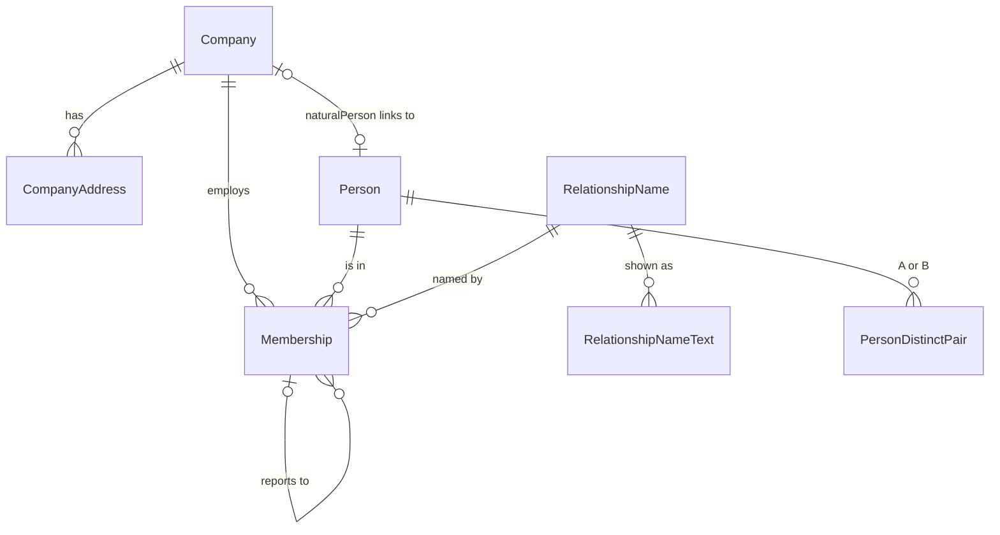

# ERD: Parties

- **Module:** `parties`, tenant-scoped (every table has a `tenantId`)
- **PRD:** [Parties](../prd/parties.md). Requirement ids (C2, M3 and so on) refer to it.
- **Status:** Draft
- **Date:** 2026-11-22

## 1. Diagram

`LegacyTombstone` stands alone (it holds hashes, not references). Nothing in this module has a foreign key to another module, and no other module has one to this module (ADR 0009, rule 1).

## 2. Conventions of every table

| Column | Type | Meaning |
|---|---|---|
| `id` | uuid | Primary key, time-ordered (version 7) |
| `tenantId` | uuid | The tenant. Part of every unique index. Every query filters by it |
| `createdAt`, `updatedAt` | timestamp (UTC) | Maintained by the platform |
| `version` | text | Concurrency token (X1). On every table that users change |
| `legacyId` | text(100), null | Identifier in the source system, prefixed with the system (G1). Unique per tenant where not null. Internal, never in the API |

Text columns hold Unicode. **Comparison keys are computed by the application** and stored (`nameKey`, normalised e-mail, normalised numbers), so the rules do not depend on the collation or case behaviour of a database.

## 3. Tables

### Company

| Column | Type | Null | Notes |
|---|---|---|---|
| `kind` | text | no | `legalEntity` or `naturalPerson` |
| `name` | text(255) | no | |
| `registrationNumber` | text(50) | yes | Stored with spaces and separators removed |
| `taxNumber` | text(50) | yes | Same |
| `country` | text(2) | yes | ISO 3166-1 alpha-2 |
| `email` | text(320) | yes | |
| `phone` | text(50) | yes | |
| `language` | text(10) | yes | Preferred language, a BCP 47 tag |
| `note` | text(2000) | yes | |
| `personId` | uuid | yes | The same human as a Person (C4). Foreign key to Person |
| `status` | text | no | `active` or `deactivated` |
| `erasedAt` | timestamp | yes | Set by erasure (D3); an erased company is also `deactivated` |

Constraints: `kind` and `status` in their sets; `personId` is null when `kind` is `legalEntity` (C4); `country` is not null when a registration or tax number is given; `erasedAt` not null implies `status` `deactivated`.
Indexes: unique `(tenantId, country, registrationNumber)` and unique `(tenantId, country, taxNumber)`, each only where the number is not null (C3); unique `(tenantId, legacyId)` where not null; `(tenantId, name)` for search; `(tenantId, personId)`.

### CompanyAddress

| Column | Type | Null | Notes |
|---|---|---|---|
| `companyId` | uuid | no | Foreign key to Company, deleted with it only by a physical purge, never by the application |
| `type` | text | no | `registeredOffice`, `postal`, `delivery`, `other` |
| `line1`, `line2` | text(255) | line2 yes | |
| `city`, `postalCode` | text(100), text(20) | city no, postalCode yes | |
| `region` | text(100) | yes | |
| `country` | text(2) | no | |
| `isPrimary` | boolean | no | |

Indexes: unique `(companyId)` where `isPrimary` is true (C2, at most one primary); `(companyId)`.
The application makes the first address primary and moves the flag in one transaction when another is chosen. Erasure deletes the address rows of an erased company (D3).

### Person

| Column | Type | Null | Notes |
|---|---|---|---|
| `firstName`, `lastName` | text(100) | no | |
| `title` | text(50) | yes | |
| `email` | text(320) | yes | Stored lower-cased |
| `phone` | text(50) | yes | |
| `language` | text(10) | yes | |
| `note` | text(2000) | yes | |
| `nameKey` | text(200) | no | Normalised full name: lower case, accents removed, whitespace collapsed, the two names sorted (P3, M2a). For an erased person it holds the record's own placeholder, so it never matches another |
| `status`, `erasedAt` | as in Company | | |

Indexes: unique `(tenantId, email)` where not null (P3); `(tenantId, nameKey)` for the namesake check; unique `(tenantId, legacyId)` where not null; `(tenantId, lastName, firstName)` for search.

### RelationshipName and RelationshipNameText

`RelationshipName`: `code` (text 50, required), `isActive` (boolean). Unique `(tenantId, code)`; unique `(tenantId, legacyId)` where not null. The starting set (R2) is inserted when the module is installed for a tenant.

`RelationshipNameText`: `relationshipNameId` (foreign key), `language` (text 10), `text` (text 100). Primary key `(relationshipNameId, language)`.

### Membership

| Column | Type | Null | Notes |
|---|---|---|---|
| `companyId` | uuid | no | Foreign key to Company |
| `personId` | uuid | no | Foreign key to Person |
| `relationshipNameId` | uuid | no | Foreign key to RelationshipName |
| `position` | text(100) | yes | Free text |
| `validFrom` | date | no | A calendar date, no time zone |
| `validTo` | date | yes | |
| `reportsToMembershipId` | uuid | yes | The manager's membership (M3) |

Constraints:
- `validTo` is null or not before `validFrom`.
- `reportsToMembershipId` is not equal to `id`.
- **Same company, enforced by the database:** a unique key `(companyId, id)` and a composite foreign key `(companyId, reportsToMembershipId)` to it, so a manager can only be a membership of the same company (M3).
Indexes: `(companyId)`; `(personId)`; `(reportsToMembershipId)`; `(tenantId, relationshipNameId)` for the "name in use" check (R1); unique `(tenantId, legacyId)` where not null.
**Rules the database cannot express** (the PRD's "Enforced by" says they run in the domain layer, in a serialisable transaction): no loop in the tree (M4); no overlap for the same person, company and relationship name (M2); no overlap for two persons with the same `nameKey` in the same company and relationship name unless a PersonDistinctPair exists (M2a); a membership with current subordinates cannot end (M6).

### PersonDistinctPair

`personAId`, `personBId` (foreign keys to Person), `confirmedBy` (uuid of the user, no foreign key: users belong to another module), `confirmedAt` (timestamp). Check `personAId` < `personBId` (the pair is stored ordered); primary key `(personAId, personBId)`. Written only under the permission `Parties.People.ConfirmDistinct` and always together with an audit event (P3).

### LegacyTombstone

`entityType` (`company`, `person`, `membership`, `relationshipName`), `keyHash` (text, the HMAC of the legacy key, D3), `erasedAt`. Unique `(tenantId, entityType, keyHash)`. Read only by the migration check (G3).

## 4. What is erased, and how

Erasure (D3) updates the row in place. For a Person: `firstName` and `lastName` become a placeholder that is unique to the record, `title`, `email`, `phone`, `note` and `legacyId` become null, `nameKey` takes the placeholder, `status` becomes `deactivated`, `erasedAt` is set, and the person's PersonDistinctPair rows are deleted. For a Company: `name` becomes a placeholder, `registrationNumber`, `taxNumber`, `email`, `phone`, `note`, `legacyId` and `personId` become null, its CompanyAddress rows are deleted, `status` becomes `deactivated`, `erasedAt` is set. In both cases a LegacyTombstone row is written when a `legacyId` existed. Memberships are not changed (D3). Because the erased values are null, the unique indexes above never block a new record.

## 5. Lookups and the contract (ADR 0009)

| Lookup | Served by |
|---|---|
| Get by id, get many by ids | primary key |
| Search companies | `(tenantId, name)`, the two number indexes, `email` |
| Search people | `(tenantId, lastName, firstName)`, `email` |
| Resolve by legacy id (migration only) | the `(tenantId, legacyId)` indexes |
| Tree of a company, direct reports, chain of managers | `Membership` by `companyId` and `reportsToMembershipId`; the chain and the loop check use a recursive query, depth bounded by the number of memberships of the company |

Every result carries the state (`status`, and whether `erasedAt` is set), never the `legacyId`.

## 6. Notes for the implementations

- **PostgreSQL and SQL Server.** The partial (filtered) unique indexes above exist in both. The unique indexes treat several nulls as allowed because they filter on "not null", which avoids the difference in how the two products treat nulls in a unique index. The domain-layer rules take a serialisable transaction because neither product has an exclusion constraint that expresses period overlap with a join.
- **No deletes.** The application never physically deletes a Company, Person, Membership or RelationshipName (D1, M6, R1). Address rows and distinct pairs can be deleted.
- **Events and audit** are written through the platform's outbox in the same transaction as the change; this module has no event table of its own.
